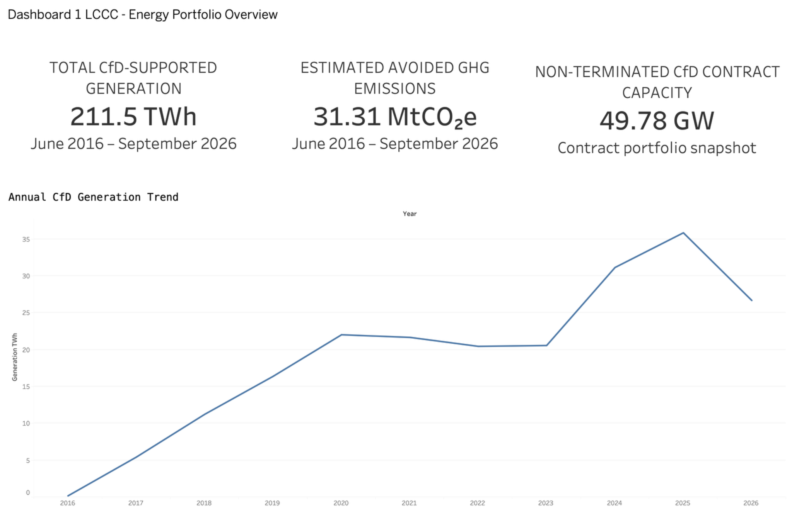
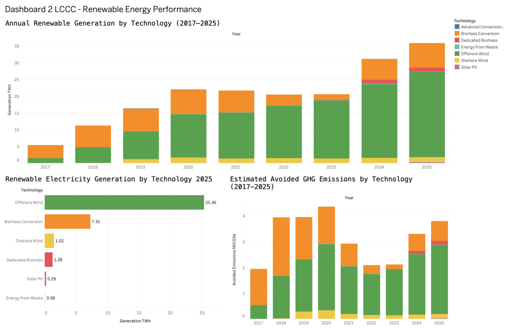
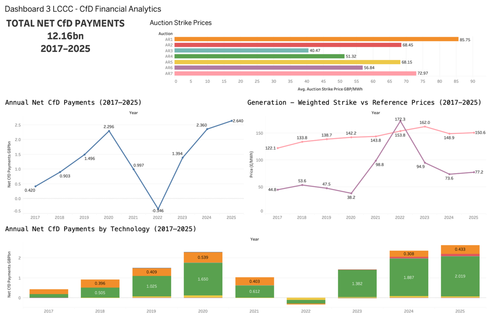
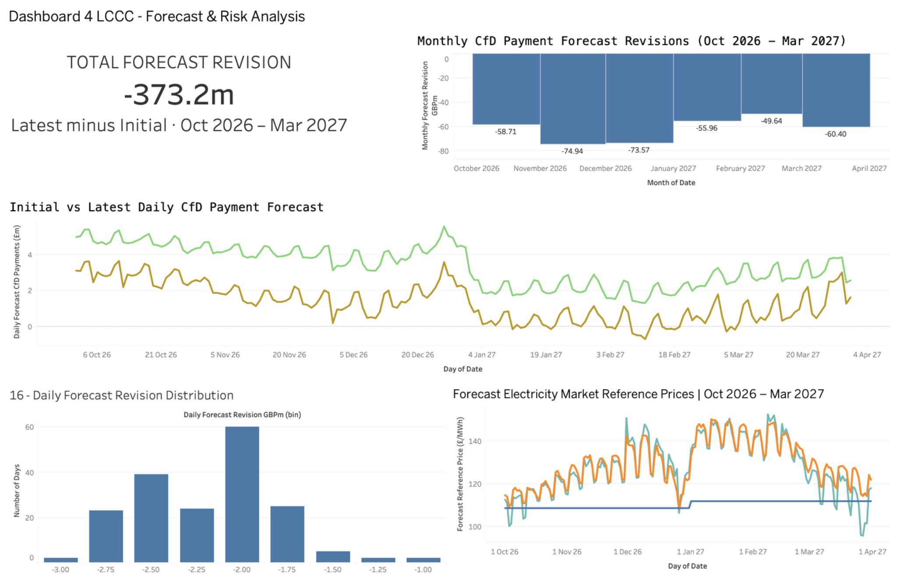
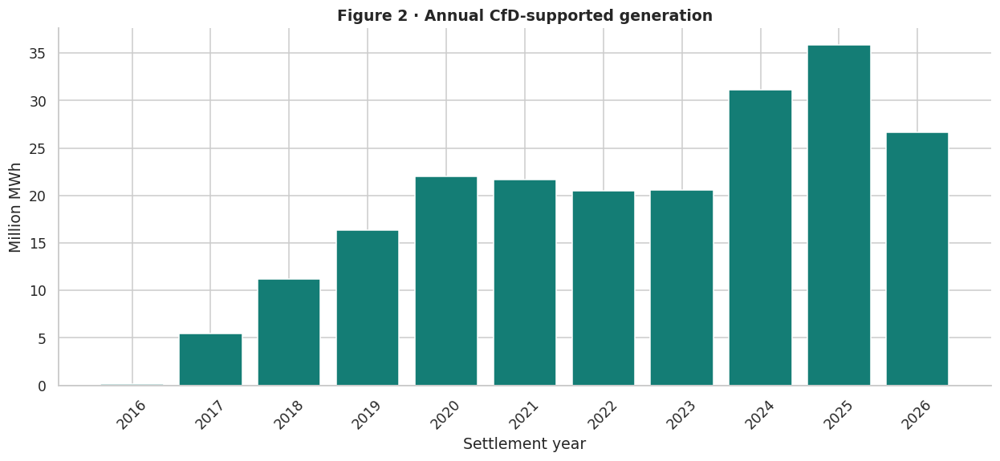
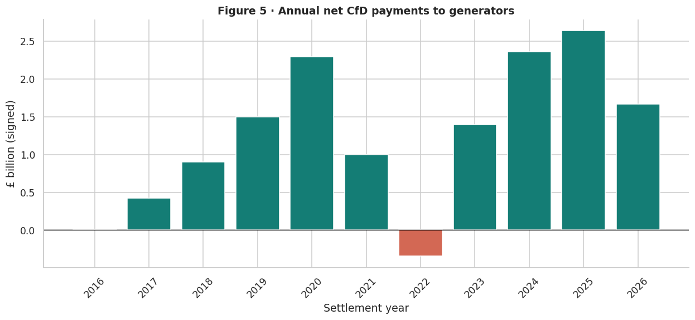
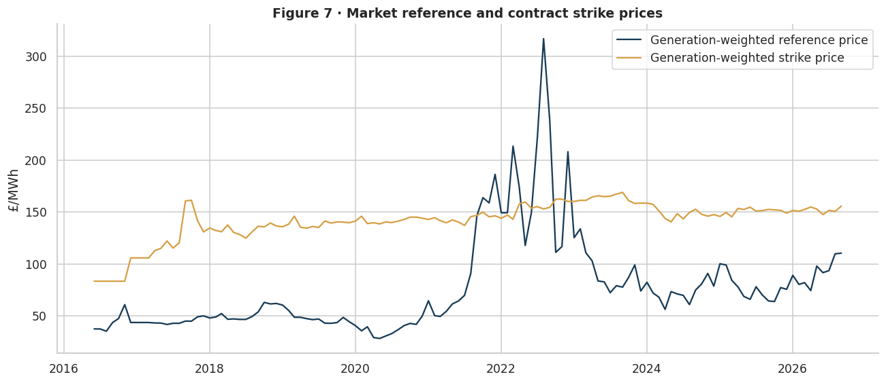
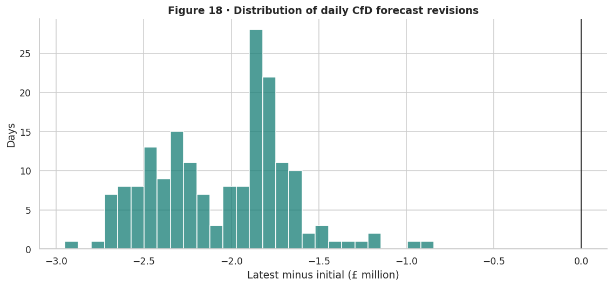

# Low Carbon Contracts Company (LCCC) | UK Contracts for Difference Energy Analytics

### Renewable Electricity Generation, CfD Financial Performance and Forecast Risk

An independent energy analytics project using open data published by the **Low Carbon Contracts Company (LCCC)**. I explored UK Contracts for Difference (CfD) generation, renewable technologies, payment flows, strike and reference prices, auction results, avoided greenhouse gas emissions and changes in payment forecasts.

I carried out the analysis in **Python and Jupyter Notebook**, prepared a consolidated dataset for **Tableau**, and developed **17 worksheets and four dashboards** to bring the findings together.

**Tools:** Python, pandas, NumPy, Matplotlib, Seaborn, Jupyter Notebook, Tableau and PowerPoint.

**Explore the work:** [Python notebook](notebooks/) | [Python visualisations](figures/python-eda/) | [Tableau worksheets](sheets/) | [Dashboards](dashboards/) | [Processed data](data/processed/) | [Presentation](presentation/)

> This is an independent portfolio project based on publicly available LCCC data. It is not an official LCCC report or an LCCC-endorsed project.

## Project objectives

I wanted to understand how the CfD portfolio has developed and how movements in electricity market prices are reflected in contract payments. The analysis focuses on five questions:

1. How much CfD-supported electricity has been generated, and how has generation changed over time?
2. Which technologies contribute most to generation and estimated avoided emissions?
3. How do net CfD payments respond to changes in strike and market reference prices?
4. What do the auction results and contract portfolio show about renewable capacity?
5. How have initial and latest payment forecasts changed for the same future dates?

## Key findings

| Measure | Result | Period or scope |
| --- | ---: | --- |
| Total CfD-supported generation | **211.54 TWh** | June 2016 to September 2026 |
| Estimated avoided GHG emissions | **31.31 MtCO₂e** | June 2016 to September 2026 |
| Non-terminated CfD contract capacity | **49.78 GW** | Contract portfolio snapshot |
| Electricity generated in 2025 | **35.84 TWh** | Calendar year 2025 |
| Offshore wind generation in 2025 | **25.36 TWh** | About 71% of CfD-supported generation in 2025 |
| Net CfD payments | **£12.16 billion** | 2017 to 2025, including negative payments |
| Revision to the payment forecast | **−£373.22 million** | Latest minus initial forecast, October 2026 to March 2027 |

A particularly interesting year was **2022**, when net CfD payments were approximately **−£0.35 billion**. The generation-weighted market reference price was approximately **£172.3/MWh**, above the weighted strike price of **£153.8/MWh**. This illustrates the two-way nature of CfD payments: depending on market conditions and the contract terms, generators may receive support or make repayments.

For the six-month forecast comparison, the initial payment forecast total was approximately **£617.39 million**, while the latest forecast was **£244.17 million**. The difference is a **60.45% downward revision**. This is a change between forecasts, not an observed financial loss or a measure of forecast accuracy.

## Tableau dashboards

I created four dashboards using a single Tableau-ready dataset. The images below are the exported Tableau dashboards; click any image to open it at full size.

### Dashboard 1 | Energy Portfolio Overview

[](dashboards/01-energy-portfolio-overview.png)

This dashboard combines historical generation, estimated avoided emissions and the non-terminated contract capacity snapshot. It also shows the annual generation trend. Generation rose substantially in 2024 and 2025; the 2026 figure covers only part of the year and should not be compared directly with complete years.

### Dashboard 2 | Renewable Energy Performance

[](dashboards/02-renewable-energy-performance.png)

This dashboard examines the generation mix across technologies, compares their contribution in 2025 and shows LCCC's estimated avoided emissions. Offshore wind is the dominant technology in the latest complete year of the historical extract, with biomass conversion making another significant contribution.

### Dashboard 3 | CfD Financial Analytics

[](dashboards/03-cfd-financial-analytics.png)

This dashboard brings together annual net payments, technology-level payments, generation-weighted strike and reference prices, and auction strike prices. It preserves negative payment values, which are important for understanding the two-way settlement mechanism. The auction averages are descriptive and not capacity-weighted.

### Dashboard 4 | Forecast and Risk Analysis

[](dashboards/04-forecast-and-risk-analysis.png)

This dashboard compares initial and latest CfD payment forecasts for **October 2026 to March 2027**. It shows the monthly revisions, the distribution of daily revisions, and forecast electricity market reference prices. Every daily payment forecast revision in the overlapping 182-day period is negative. These are forecast-to-forecast comparisons, not actual-versus-forecast errors.

## Tableau worksheets

All **17 exported worksheets** are available in the [`sheets`](sheets/) folder. Each sheet contributed to one of the four dashboards.

| No. | Worksheet | Dashboard |
| --- | --- | --- |
| 01 | [Annual CfD Generation Trend](sheets/01-annual-cfd-generation-trend.png) | Energy Portfolio Overview |
| 02 | [Generation by Technology](sheets/02-generation-by-technology.png) | Renewable Energy Performance |
| 03 | [Generation Ranking for 2025](sheets/03-generation-ranking-2025.png) | Renewable Energy Performance |
| 04 | [Estimated Avoided Emissions](sheets/04-estimated-avoided-emissions.png) | Renewable Energy Performance |
| 05 | [Total Generation KPI](sheets/05-kpi-total-generation.png) | Energy Portfolio Overview |
| 06 | [Avoided Emissions KPI](sheets/06-kpi-avoided-emissions.png) | Energy Portfolio Overview |
| 07 | [Contract Capacity KPI](sheets/07-kpi-contract-capacity.png) | Energy Portfolio Overview |
| 08 | [Annual Net CfD Payments](sheets/08-annual-net-cfd-payments.png) | CfD Financial Analytics |
| 09 | [Net Payments by Technology](sheets/09-net-payments-by-technology.png) | CfD Financial Analytics |
| 10 | [Strike vs Reference Prices](sheets/10-strike-vs-reference-prices.png) | CfD Financial Analytics |
| 11 | [Net Payments KPI](sheets/11-kpi-net-payments.png) | CfD Financial Analytics |
| 12 | [Auction Strike Prices](sheets/12-auction-strike-prices.png) | CfD Financial Analytics |
| 13 | [Initial vs Latest Payment Forecast](sheets/13-initial-vs-latest-forecast.png) | Forecast and Risk Analysis |
| 14 | [Monthly Forecast Variance](sheets/14-monthly-forecast-variance.png) | Forecast and Risk Analysis |
| 15 | [Forecast Revision KPI](sheets/15-kpi-forecast-revision.png) | Forecast and Risk Analysis |
| 16 | [Daily Revision Distribution](sheets/16-daily-revision-distribution.png) | Forecast and Risk Analysis |
| 17 | [Forecast Market Reference Prices](sheets/17-forecast-reference-prices.png) | Forecast and Risk Analysis |

## Python exploratory data analysis

I used Python for data loading, cleaning, missing-value checks, date handling, exploratory data analysis and preparation of the Tableau output. The executed [Jupyter notebook](notebooks/) includes commentary and visualisations, and the [`figures/python-eda`](figures/python-eda/) folder contains **18 exported Python charts**.

The analysis includes:

- Data completeness and validation across the input datasets.
- Annual and monthly CfD-supported generation, including the technology mix.
- Net payment trends and technology contributions, keeping negative values.
- Generation-weighted strike and reference prices.
- Estimated avoided emissions and individual project contributions.
- Contract status, maximum contract capacity and auction outcomes.
- Forecast reference prices and revisions to daily payment forecasts.

A few examples from the Python analysis:

| Generation trends | Net CfD payments |
| --- | --- |
|  |  |
| **Reference and strike prices** | **Forecast revisions** |
|  |  |

## Data and preparation

**Source:** [LCCC Open Data Portal](https://dp.lowcarboncontracts.uk/dataset)

I used six published datasets:

| Dataset | Used for |
| --- | --- |
| Actual CfD Generation and Avoided GHG Emissions | Historical electricity generation, payments, prices and estimated emissions |
| CfD Contract Portfolio Status | Contract status and maximum contracted capacity |
| Auction Outcomes | Awarded capacity, allocation rounds and strike prices |
| Forecast Average Strike Price and Market Price | Financial-year price benchmarks |
| Forecast Market Reference Prices | Future baseload and intermittent price series |
| In-period Tracking | Initial and latest daily payment forecasts and revisions |

The original extracts are stored under [`data/raw`](data/raw/), and the Tableau output is stored under [`data/processed`](data/processed/).

The consolidated Tableau dataset contains **47,361 rows**, **26 metrics** and **six record groups**. It uses a long-format structure to place different published measures in one file while retaining their units, reporting periods and source groupings. I filter by the relevant metric and record group in Tableau rather than summing unrelated measures together.

## Repository structure

```text
LCCC-UK-Contracts-for-Difference-Energy-Analytics/
├── README.md
├── dashboards/           Four exported Tableau dashboards
├── data/                 Raw LCCC CSVs and processed Tableau CSV
├── figures/
│   └── python-eda/       Eighteen Python visualisations
├── notebooks/            Executed Jupyter Notebook
├── presentation/         Project PowerPoint
├── sheets/               Seventeen exported Tableau worksheets
└── tableau/              Tableau-related files and notes
```

## How to explore the project

1. Start with the four [Tableau dashboards](dashboards/) to see the main findings.
2. Open the individual [Tableau worksheets](sheets/) to inspect each chart or KPI.
3. Review the [Jupyter notebook](notebooks/) for the Python methodology and executed outputs.
4. Browse the [Python figures](figures/python-eda/) for individual EDA results.
5. Use the CSV in [processed data](data/processed/) to explore the metrics in Tableau.
6. Open the [presentation](presentation/) for the project narrative, visualisations and explanations.

To rerun the Python notebook locally, use Python 3.10 or later with pandas, NumPy, Matplotlib, Seaborn, Jupyter and IPython installed. Keep the original input CSV files in `data/raw/` with their existing filenames because the notebook reads them using relative paths.

**Tableau note:** The exported dashboard and worksheet images are included. The editable `.twbx` workbook is separate and should only be described as available once it has been uploaded to the [`tableau`](tableau/) folder.

## Important limitations

- The dataset represents **CfD-supported generation**, not all renewable electricity generated in the UK.
- The historical series starts during 2016 and currently ends in September 2026, so the first and final years are incomplete.
- Avoided greenhouse gas emissions are **estimates**, not directly measured emission reductions.
- The 49.78 GW capacity KPI is a snapshot of non-terminated contracts, not the capacity currently producing electricity.
- Auction strike-price averages are **unweighted** and may not be directly comparable across rounds because of differences in technologies and price bases.
- Net CfD payment values are signed, and negative values should be retained.
- Forecast revisions compare two versions of forecasts. The supplied tracking extract does not contain populated actual payment values for measuring forecast accuracy.
- Price metrics are not additive; historical aggregate prices use generation weighting.

## Attribution

Data published by the **Low Carbon Contracts Company** through the [LCCC Open Data Portal](https://dp.lowcarboncontracts.uk/). Check the licence and attribution terms on each dataset page when reusing or redistributing the source data.

This project is my independent analysis and is not affiliated with or endorsed by LCCC.
